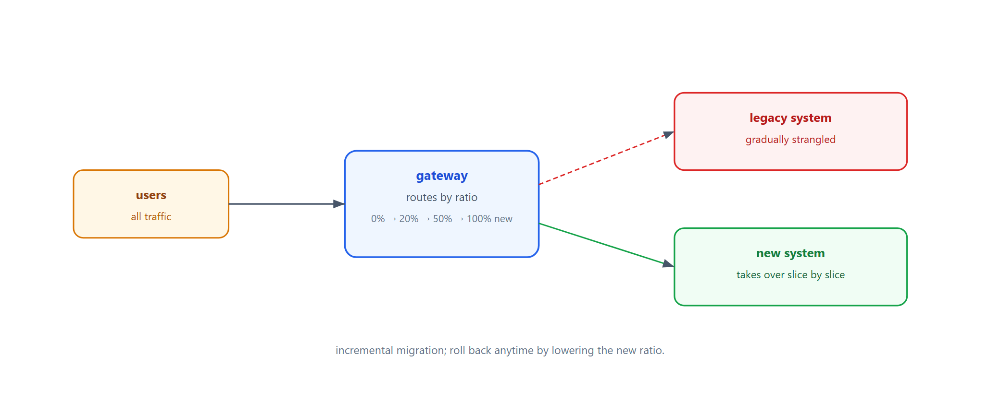
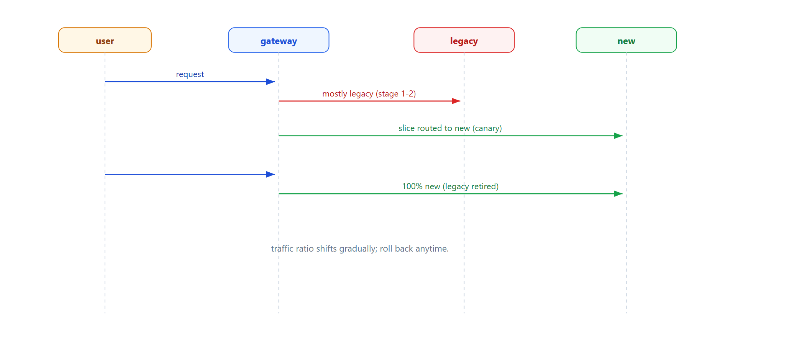

# Learn Strangler Fig — Gradually Replace a Legacy System

> **Learning / study repo. Self-contained demo, NOT production code.**
> A gateway sits in front of old and new systems. Traffic is gradually shifted from legacy
> to new, slice by slice, until the old system is fully strangled and can be turned off.

## The idea

```
  users ──► gateway ──► 100% legacy  (stage 1)
                     ├─►  20% new    (stage 2, canary)
                     ├─►  50% new    (stage 3)
                     └─► 100% new    (stage 4, legacy retired)
```

- No big-bang rewrite.
- Each slice of functionality moves to the new system.
- Roll back any time by lowering the new-traffic ratio.
- Once everything is on the new system, decommission the old.



## Why this matters

- **Low risk** — migrate incrementally; failures are small and reversible.
- **No downtime** — users keep using the system throughout.
- **Business can validate** — each stage is a real production check.

## Run

```bash
python run_all.py
```

Pure Python standard library.

## Demo stages

1. **100% legacy** — all traffic goes to the old system.
2. **20% new (canary)** — small slice to the new system.
3. **50/50** — half on new.
4. **100% new** — legacy strangled and retired.

## Flow



## Sibling repos

- `learn_bff_gateway` — the gateway can also aggregate backends.
- `learn_sidecar_proxy` — per-service cross-cutting layer.
- `learn_circuit_breaker` — protect the new backend during rollout.
